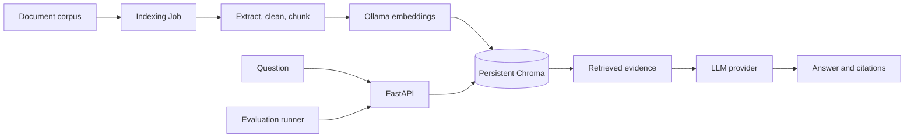
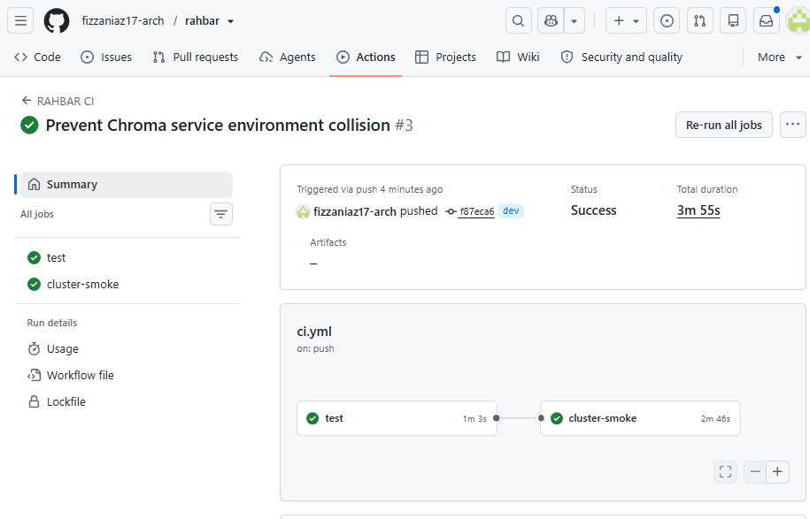
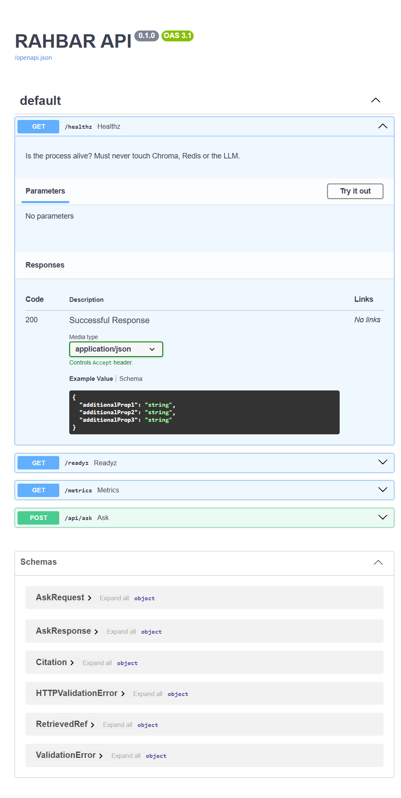

# RAHBAR

[](https://github.com/fizzaniaz17-arch/rahbar/actions/workflows/ci.yml)

RAHBAR is a university-policy question-answering service that retrieves source passages from a
versioned document corpus and returns grounded answers with citations. Its API reads a Chroma
index, while a dedicated Kubernetes indexer Job owns writes; CI and the existing evaluation
runner check the API and retrieval behavior. The current dev overlay uses stubs, while real
model evaluation and the production rollout require local Ollama and Minikube.

## Architecture



## From a clean clone to an answered question

Run these commands from `rahbar-starter/` in WSL 2 or another environment with
`make`, Docker, Minikube and `kubectl` installed:

```sh
git clone https://github.com/fizzaniaz17-arch/rahbar.git
cd rahbar/rahbar-starter
make install
make test
make cluster
make images
make apply
kubectl -n rahbar wait --for=condition=complete job/indexer --timeout=10m
kubectl -n rahbar rollout status deployment/api --timeout=3m
kubectl -n rahbar rollout status deployment/ui --timeout=3m
make ask Q="What does the starter return?"
```

The exact development apply order is: start Minikube and its addons with `make cluster`,
build and load the images with `make images`, apply `k8s/overlays/dev` with `make apply`,
wait for the indexer Job, then wait for the API and UI rollouts before asking a question.
The equivalent direct apply command is `kubectl apply -k k8s/overlays/dev`.
The dev overlay intentionally uses a dummy index and stub answers.

## API endpoints

| Method | Path | Purpose |
| --- | --- | --- |
| GET | `/healthz` | Liveness only; does not contact dependencies. |
| GET | `/readyz` | Dependency and embedding-pin readiness. |
| GET | `/metrics` | Prometheus request and latency metrics. |
| POST | `/api/ask` | Grounded answer with citations and retrieved passages. |

### Trace and coverage tools

Query traces are emitted as JSON logs and written to the configured trace file
(`TRACE_PATH`, defaulting to the OS temporary directory; Kubernetes mounts a
persistent claim at `/traces/traces.jsonl`):

```sh
cd api
python -m app.trace_inspect --trace-id REQUEST_ID
python -m app.trace_metrics --hours 24
```

Query coverage uses the configured Ollama embedding model; it does not invent a
coverage score when the model service is unavailable:

```sh
cd ..
python eval/coverage.py --ollama-url http://localhost:11434
```

### Existing development evidence

The image below is an existing CI development-smoke capture committed with the repository; it
is not evidence of a Minikube deployment run in this workspace.



### Current cluster evidence

This Swagger UI capture was taken from the running `rahbar-real-eval` API on
2026-11-25. It documents the current API surface; it is not evidence of a
model-backed evaluation or a deployment of the unpushed tracing changes.



See the [Kubernetes runbook](k8s/README.md) for deployment, tracing, and
troubleshooting commands.

## Kubernetes development smoke test

Run these from this project directory (the `rahbar-starter/` directory in GitHub).
Use Docker, minikube, and kubectl.

```sh
make cluster
make images
make apply
kubectl -n rahbar wait --for=condition=complete job/indexer --timeout=10m
kubectl -n rahbar rollout status deployment/api --timeout=3m
kubectl -n rahbar rollout status deployment/ui --timeout=3m
make ask Q="What does the starter return?"
```

The dev overlay uses the dummy index and stub answers. The CPU and memory
settings are initial values pending live measurements. Use
`kubectl -n rahbar top pods --containers` while the indexer is active, and
capture the API endpoints and HPA with `kubectl -n rahbar get endpoints api`
and `kubectl -n rahbar get hpa api`. Save the verified evidence in
`docs/evidence/`.

For the model-pin check, change `EMBED_MODEL` in the live ConfigMap and
restart the API without running the indexer. Capture the unready replacement
pod and the model mismatch in its logs. Reapply the dev overlay and restart
the API again to restore the shared model pin.

### Publish the development images

Set the GitHub Actions repository variable `DOCKERHUB_USERNAME` and secret
`DOCKERHUB_TOKEN` (a Docker Hub access token with push access). The CD workflow
runs on main after merge, publishes the three commit-SHA tags, then checks those
images on a fresh kind cluster. Its smoke check uses the stub provider. The
Docker Hub repositories must allow pulls by the kind cluster.

### Run against a real corpus

The production overlay requires a running Ollama Service named `ollama` in
namespace `rahbar`, backed by pods labeled `app: ollama` with
`nomic-embed-text` and the configured `LLM_MODEL` preloaded. Provision and
populate the `rahbar-corpus` PVC with the source files and their metadata
before starting the indexer. Set commit-SHA image tags in the overlay before
applying it. Use a separate cluster for this overlay so the initial indexer Job
has a clean name and the development stack remains available.

## Assignment 03 verification commands

Run these commands from `rahbar-starter/`:

```sh
# A1-A3: data verification and incremental reuse
cd indexer
python -m pytest -q tests/test_verification.py tests/test_batch_ingestion.py tests/test_incremental.py
python -c "from pipeline.models import Chunk; from pipeline.store import reusable_embeddings; c=Chunk('chunk-1','policy text','rules.pdf','Attendance',1,'2026',False); existing={'chunk-1':('policy text',c.metadata(),[0.1,0.2])}; reusable,pending=reusable_embeddings([c],existing); print('pending_embeddings=',len(pending)); print('embedded_chunks=0')"

# B2-B3: embedding experiment, coverage, and evaluation
cd ..
python eval/embedding_experiment.py --ollama-url http://localhost:11434
python eval/coverage.py --ollama-url http://localhost:11434
python eval/run_eval.py --api http://localhost:8000 --golden eval/golden.yaml

# C: controlled release-gate outcomes
python -c "from eval.run_eval import GateThresholds,gate; r={'recall@5':0.90,'citation_validity':0.96,'abstention_correctness':1.0}; print(gate(r,{'recall@5':0.96},GateThresholds())); print(gate(r,{'recall@5':0.93},GateThresholds()))"

# D: durable trace reconstruction
kubectl -n rahbar exec deployment/api -- python -m app.trace_inspect \
  --trace-id REQUEST_ID --path /traces/traces.jsonl
kubectl -n rahbar exec deployment/api -- python -m app.trace_metrics \
  --path /traces/traces.jsonl --hours 24

# E: coverage before and after
python eval/coverage.py --golden eval/golden.yaml --live eval/live_queries.jsonl \
  --ollama-url http://localhost:11434 --out eval/results/coverage-live.json

# F: namespace, Jobs, thresholds, rollout and rollback
kubectl -n rahbar get all,pvc,configmap,cronjob,job
kubectl -n rahbar logs job/indexer-600-75 --tail=80
kubectl -n rahbar apply -f k8s/base/evaluation-job.yaml
kubectl -n rahbar wait --for=condition=complete job/evaluation --timeout=20m
kubectl -n rahbar logs job/evaluation
kubectl -n rahbar get configmap rahbar-release-gate -o yaml
kubectl -n rahbar rollout status deployment/api --timeout=3m
kubectl -n rahbar rollout undo deployment/api
kubectl -n rahbar rollout status deployment/api --timeout=3m
```

Submission screenshots and terminal captures are stored in
[`docs/evidence/submission-screenshots/`](docs/evidence/submission-screenshots/).
The combined PDF and editable DOCX submission reports are stored in
[`docs/submission/`](docs/submission/).
